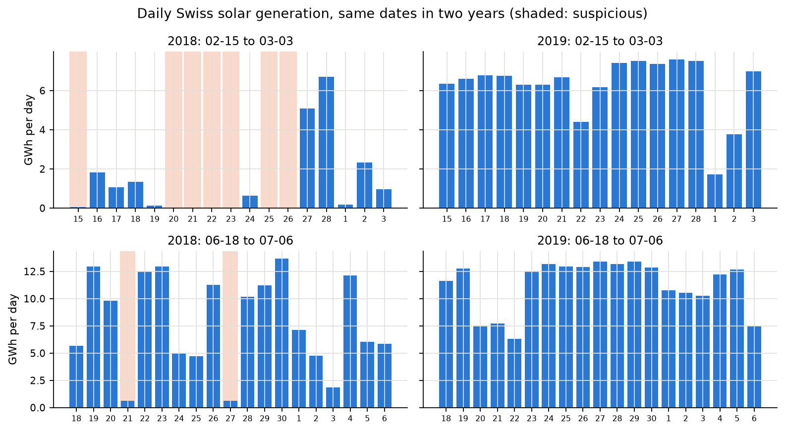
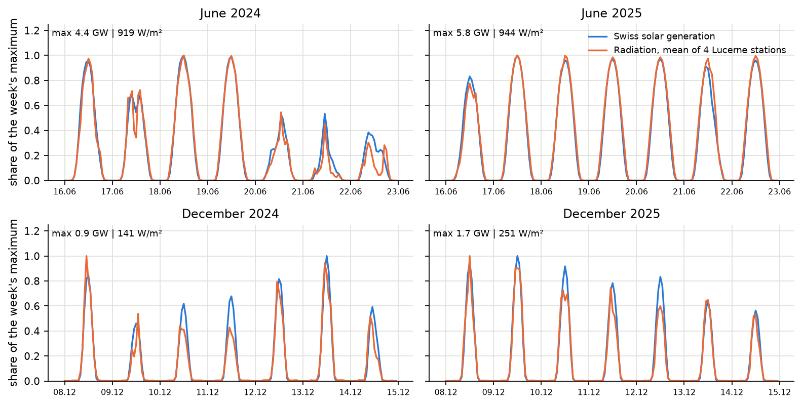
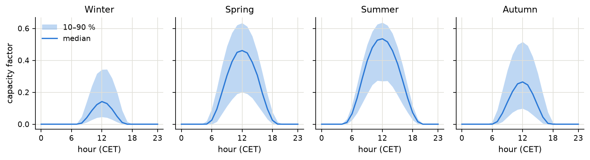

# Project Report

*The project will be structured using the CRISP-DM framework. Details about the framework can be found [here](https://www.datascience-pm.com/crisp-dm-2/). We will not conduct the deployment step. This page will serve as your project report. The current content provides a rough structure and helps you keep track of the deadlines for each deliverable. The first- and second-level headings should remain as provided in the template. All other content can be freely edited and adapted to your project.*

## Project Details

> ⚠️ **Deliverable - 24.09.2026:** Add the names of all team members and their non-binding tasks. Invite all coaches to your repositories.

### Team Members

| Name | Major task |
|--------|------------|
| Elias Schwegler | TBD — data sourcing / modelling |
| Flurin Yenigün | TBD — analysis / visualisation |

### Project Name

> ⚠️ **Deliverable - 15.10.2026:** Define a project name.

**Untapped Sun – Forecasting Solar Generation in Lucerne**

### Pitch

> ⚠️ **Deliverable - 15.10.2026:** Write a short pitch.

*Write a 3 to 5 sentence pitch using [this](https://www.linkedin.com/posts/maabrahams_how-to-make-a-compelling-quick-pitch-activity-7179128237782970369-Qa6o/) as a guideline.*

**What if you could** build a complete picture of solar power in Canton Lucerne from open data alone? **So that** planners and grid operators can see how fast the region's PV fleet has grown (17,205 plants, 647 MW), estimate how much it produces under different weather and seasons, and how much roof and facade potential remains, which helps raise the share of renewable energy. **For example,** we combine the SFOE plant register (capacity, start date, tilt and orientation), MeteoSwiss radiation and temperature from station Luzern, and hourly Swiss solar generation from Energy-Charts into one cleaned, hourly dataset. **And that's not all:** this dataset lets us explore seasonal patterns, such as the winter share, and test how well a simple weather-based forecast works.

---

# 1. Business Understanding

## Problem Statement

> ⚠️ **Deliverable - 22.10.2026:** Write a short problem statement.

*Describe the problem that should be solved in two sentences.*

Canton Lucerne’s solar capacity doubled from 326 MW at the end of 2022 to 652 MW in October 2026, and its output fluctuates strongly with weather and season, which makes grid planning and the shifting of flexible loads (heat pumps, EV charging, batteries) harder. We investigate how well hourly solar generation in Lucerne can be forecast one day ahead from open data with a SARIMAX model.

## Goals

> ⚠️ **Deliverable - 22.10.2026:** Formulate goals for you project.

*Which goals are you aiming for? Define 2 to 4 goals. Goals should follow the [SMART](https://www.atlassian.com/blog/productivity/how-to-write-smart-goals) definition, with a focus on measurability.*

| # | Goal | Measured by | Due |
|---|---|---|---|
| G1 | Build one cleaned, documented hourly dataset for 2019–2025 that combines Swiss solar generation (Energy-Charts), installed PV capacity for Switzerland and Canton Lucerne (SFOE plant register), global radiation from four MeteoSwiss stations in Canton Lucerne plus Pilatus, and archived day-ahead weather forecasts for Lucerne (Open-Meteo Previous Runs API, test year 2025). | Coverage ≥ 99 % of hours after cleaning; every cleaning step (time-stamp alignment, removal of erroneous days and values) documented in the notebook | 12.11.2026 |
| G2 | Quantify how strongly solar generation follows the weather. | Pearson correlation between hourly capacity factor and irradiation, reported per season; effect of fog and snow quantified; daily and seasonal profiles shown | 12.11.2026 |
| G3 | Build a day-ahead SARIMAX forecast of the hourly capacity factor that only uses information available the day before (archived weather forecasts), and translate it to Lucerne via its installed capacity. | Forecast skill in the test year 2025, skill = 1 − MAE(model) / MAE(reference), against (a) the same hour of the previous day (MAE 27.6 %) and (b) the radiation forecast × one factor per month (MAE 16.3 %). Target: skill ≥ 10 % against (b), i.e. MAE ≤ 14.7 %. RMSE and R² are reported as well; R² alone is not used, because the position of the sun already explains 85 % of the variance. The Lucerne estimate is validated against measured cantonal feed-in (Pearson r ≥ 0.95). | 03.12.2026 |

*The dashboard (final product) presents the results of G2 and G3.*

---

# 2. Data Understanding

## Data Sources

> ⚠️ **Deliverable - 12.11.2026:** Define data sources.

*You are free to choose any data source. As a starting point you might consider [Kaggle](https://www.kaggle.com/datasets) or Swiss open data platforms (e.g. Open Government Data [Zurich](https://www.stadt-zuerich.ch/de/politik-und-verwaltung/statistik-und-daten/open-government-data.html), [Luzern](https://www.stadtluzern.ch/opengovernmentdata), or [Switzerland](https://opendata.swiss/de)) as potential data sources.*

| Data source | Description |
|-------------|-------------|
| [Energy-Charts](https://api.energy-charts.info) (Fraunhofer ISE), public net generation of Switzerland | **Target.** Hourly Swiss solar generation in MW since 2015. National, extrapolated from reference plants and scaled to the official SFOE totals. CC BY 4.0, "energy-charts.info". EDA: [energy_charts_eda.ipynb](notebooks/energy_charts/energy_charts_eda.ipynb) |
| [MeteoSwiss SwissMetNet](https://opendatadocs.meteoswiss.ch/a-data-groundbased/a1-automatic-weather-stations) | **Measured weather.** Hourly global radiation, sunshine, temperature and snow depth at Luzern, Mosen, Schüpfheim and Egolzwil in Canton Lucerne, plus Pilatus (2,105 m, usually above the fog). CC BY 4.0, "Source: MeteoSwiss". EDA: [meteoswiss_eda.ipynb](notebooks/meteoswiss/meteoswiss_eda.ipynb) |
| [SFOE plant register](https://opendata.swiss/de/dataset/elektrizitatsproduktionsanlagen), with the official capacity from Energy-Charts | **Installed capacity.** Every PV plant in operation with power, start date and canton. Gives the daily capacity of Switzerland and Lucerne, scaled to the official capacity per year. Source: SFOE, opendata.swiss. EDA: [bfe_register_eda.ipynb](notebooks/bfe_register/bfe_register_eda.ipynb) |
| [Open-Meteo Previous Runs API](https://open-meteo.com/en/docs/previous-runs-api) | **Day-ahead forecast.** Archived ICON-D2 forecasts of radiation, temperature and cloud cover, made one day before, at the four Lucerne stations, 2024–2025. CC BY 4.0, "Open-Meteo.com", free for non-commercial use. EDA: [open_meteo_eda.ipynb](notebooks/open_meteo/open_meteo_eda.ipynb) |

All sources are open data. The raw files are not in the repository: every notebook folder has a `download_data.py` that fetches them.

## Exploratory Data Analysis

> ⚠️ **Deliverable - 12.11.2026:** Conduct an exploratory data analysis.

*A hands-on definition of EDA can be found [here](https://www.geeksforgeeks.org/data-analysis/what-is-exploratory-data-analysis/). The implementation of the EDA should be contained in a dedicated notebook.*

- Notebook to run the EDA: [combined_eda.ipynb](notebooks/combined/combined_eda.ipynb). It holds the whole EDA in one place: (A) the four sources loaded into one hourly table for 2019–2025 (`data/processed/hourly_dataset.csv`, 61,368 hours × 24 columns) with a data dictionary of every column, (B) data quality and **one decision log for all sources**, (C) distribution, spread and daily profiles, (D) the relationship with the weather (G2), (E) leakage check and baseline. The four source notebooks (table above) contain the detailed checks of each source.
- To reproduce: `pip install -r requirements.txt`, run `python download_data.py` in the four folders `notebooks/energy_charts`, `meteoswiss`, `bfe_register` and `open_meteo`, then the notebooks.
- Every question in the notebooks ends with *Finding → Consequence*. Every decision states whether the issue is an error or a characteristic of the data.
- All time stamps are converted to fixed CET (UTC+1, no clock changes); each stamp marks the start of the hour.

### Data Quality

*Short description of the results from the EDA with respect to data quality issues, such as coverage, data types, missing values, etc.*

- **Coverage:** after cleaning, 99.57 % of the 61,368 hours of 2019–2025 are complete (G1: at least 99 %). The 266 missing hours are 11 error days in 2019 and two impossible night values (415 MW at midnight in September 2022). Nothing is filled.
- **Gaps with a cause:** three outages at Mosen (167 hours; the station mean uses the other three), snow depth only measured since November 2023, ICON-D2 forecasts only since 19 January 2024.
- **Disguised missing values:** zeros in the solar series on sunny days. 2018 fits the weather far worse than every other year, so we leave it out instead of rebuilding it from radiation; 2015 contains only 19 % of the official total. Real zeros also exist: on 25 winter days snow covered the panels, these days are kept and flagged (`is_snow_cover_day`).
- **Consistency checks:** the annual solar sums match the official SFOE statistics. The register matches the official capacity until 2020 but covers only about 91 % from 2022 on, so we scale it to the official capacity per year.
- **Time stamps:** the sources come in UTC with different conventions (start or end of the hour, mean of the preceding hour). After the conversion, solar and radiation correlate best at zero shift.
- **Sensor errors:** a night offset at Egolzwil (night hours set to 0), "snow" in summer at Schüpfheim (set to missing from May to September), plant parts with 1,000 times too much power in `PlantDetail` (not used).
- **Decision log:** all decisions of all sources are in one table in `combined_eda.ipynb`, end of Part B.

### Insights

*List insights from the EDA with respect to the problem statement. Is the data suitable for reaching your goals?*

- **Solar follows the weather (G2 reached):** the hourly capacity factor correlates with the Lucerne radiation at r = 0.98. In daylight only, r is 0.91 in winter and 0.96 in summer. Weighting the stations by installed capacity does not beat the simple mean.
- **Profiles and spread:** the capacity factor peaks at 12:00 CET in every season (median 0.14 in winter, 0.54 in summer); in daylight its median ranges from 0.08 in winter to 0.27 in summer. The distribution is skewed and its spread depends on the season, so we report medians and errors per season. The series repeats every 24 hours (autocorrelation 0.91), while the weather itself lasts only about one day.
- **Winter is the weak spot:** on fog days (Pilatus far brighter than Lucerne, 15 % of the winter days) Swiss solar is about 27 % higher than the Lucerne radiation explains. Fog comes in periods: after a fog day the next day is foggy in 53 % of the cases, otherwise in 9 %. Snow on the panels pushes 25 winter days below 35 % of the expected output (1.7 % of the energy from November to February).
- **The day-ahead weather forecast is a good input, except in fog:** the ICON-D2 radiation correlates with the measurement at r = 0.97 per hour (0.94 in daylight only; r shows whether the curves move together, not whether the level is right). Over the year it is unbiased, but on 42 fog days it forecasts 86 % too much. The daily error is 8–9 % from April to August, 36 % in October and 47 % in December.
- **Baselines for G3** (test year 2025, MAE in % of the mean): a constant is off by 124 %, the position of the sun alone (mean of the same month and hour) by 30.8 %, the same hour of the previous day by 27.6 %, the weather forecast × monthly factor by 16.3 %. The G3 target is therefore an MAE of at most 14.7 %. We judge forecasts by their error against such a reference rather than by R², because the position of the sun alone already explains 85 % of the variance. Even the measured radiation reaches only 16.0 % with the simple factor, and the error of the day before hardly helps (r = 0.16), so the model has to convert radiation better (hour of the day, season) and use signals known the day before, such as yesterday's fog.
- **Leakage:** only the `forecast_*` columns, past values, calendar features and the capacity of the previous day may be model inputs. Measured weather is known only afterwards.
- **Is the data suitable?** Yes for G1 and G2, partly for G3: the forecasts cover the test year, but only one earlier year (2024) is available for training. The target is national while the weather comes from Canton Lucerne.

### Visualizations

The entire set of visualizations can be found in `figures/eda` (combined notebook) and `figures/eda/sources` (detail figures of the source notebooks). All figures use one style, defined in `src/plot_style.py`.

*Data quality: on the same dates, 2018 shows days with almost no solar although the sun was shining (shaded). We leave 2018 out.*

*G2: Swiss solar (blue) and the mean radiation of the four Lucerne stations (orange), each as share of the week's maximum, almost overlap in summer and in winter.*

*G2, daily and seasonal profiles: median capacity factor per hour (line) and the band of 80 % of the hours. The peak is always at 12:00 CET; the weather decides its height.*

---

# 3. Data Preparation
*Data preparation (also known as feature engineering) consists of steps such as cleaning, filtering, joining, [aggregating](https://www.geeksforgeeks.org/python/grouping-and-aggregating-with-pandas/), [normalizing](https://www.geeksforgeeks.org/python/data-normalization-with-pandas/), and transforming the data. The goal is to have one dataset that contains all features and is ready to be used in the follow-up data modeling. All data preparation is contained in one notebook that may use modular code. Data preparation is not a deliverable but goes hand in hand with the follow-up step of data modeling.*

- Notebook to run the data preparation: [02_data_preparation.ipynb](notebooks/02_data_preparation.ipynb)
- Reusable, modular code is outsourced to separate `.py` files: [src/data_preparation.py](src/data_preparation.py)

## Features

*List and describe each feature.*

| Feature | Description |
|---------|-------------|
|         |             |
|         |             |
|         |             |

---

# 4. Data Modeling

> ⚠️ **Deliverable - 03.12.2026:** Summarize the data modeling approach.

## Concept
*Describe the data modeling approach in a few sentences. Which major tasks have to be performed? Which types of models are used (why)? What are the results? The goal of DSPRO1 is not to implement complex ML algorithms but to tell a coherent data story. A dashboard visualisation or a classical statistical analysis cab be sufficient in terms of data modeling.*

## Implementation
*Make a reference to the notebook and scripts used for performing the data modeling. Sketch a diagram that contains all major tasks and notes for the corresponding implementation.*

- Notebook to run the data modeling: [03_modeling.ipynb](notebooks/03_modeling.ipynb)
- Reusable, modular code is outsourced to separate `.py` files: [src/data_modeling.py](src/data_modeling.py)

# 5. Evaluation

> ⚠️ **Deliverable - 10.12.2026:** Discuss your results in the light of the project goals.

- Notebook to run the evaluation: [04_evaluation.ipynb](notebooks/04_evaluation.ipynb)

- All visualizations can be found in `figures/eval`.

## Results
*List major results. Results often come in the form of evaluation metrics.  A short introduction can be found [here](https://www.ibm.com/think/topics/model-evaluation).*

## Interpretation
*Interpret results in the light of the problem statement. Could you solve the problem? An important issue in the interpretation is practical applicability. Is your solution generalizable?*

## Limitations
*Describe weaknesses of your approach or the underlying data.*

---

# 6. Sustainable Development Goals

> ⚠️ **Deliverable - 17.12.2026:** Describe your results in the light of sustainability.

*The United Nations distinguishes 17 Sustainable Development Goals ([link](https://sdgs.un.org/goals)). Put the results of your project in relation to at least one of these goals. A four-sentence description is sufficient.*
